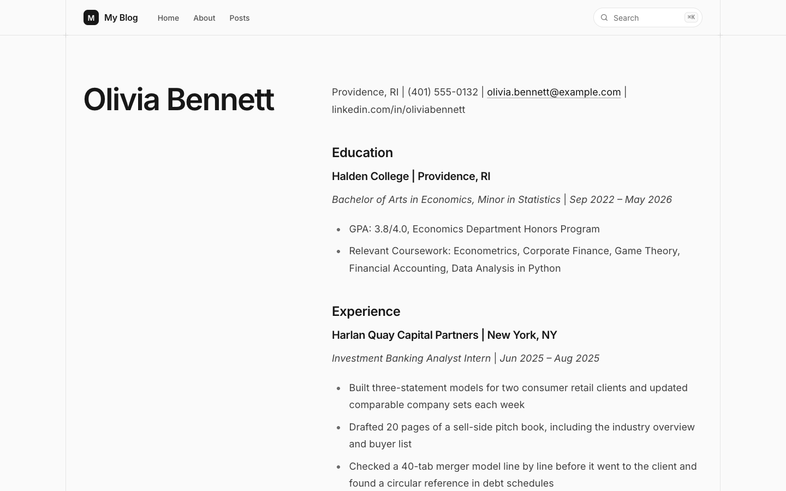
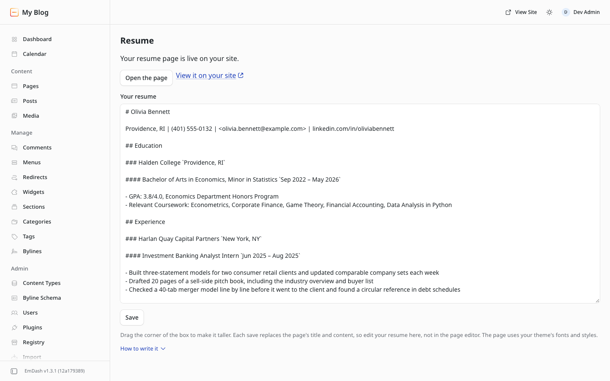

# Readable Resume for EmDash

An EmDash plugin that puts your resume on your site.
You write it in Markdown on a page in the admin, press Save, and the plugin
keeps a page in your Pages collection up to date with it. The structure is the
Classic layout from [ReadableResume](https://readableresume.com): your name,
a contact line, then sections with a line for each job or school, the role
and dates under it, and bullets.



The page is one column of headings, paragraphs and bullets in the order you
read them. Nothing is an image or a table, so the text copies cleanly and a
screen reader goes through it top to bottom.

## What it needs

- EmDash 1.3 or later. It was tested on 1.3.1.
- A sandbox runner, which any plugin installed from the registry needs: Node.js
  with `workerd`, or Cloudflare Workers on the paid plan. See
  [Plugin Sandbox](https://docs.emdashcms.com/deployment/plugin-sandbox/) in the
  EmDash docs.
- A collection named `pages` with a `title` field and a Portable Text field named
  `content`, plus a route on your site that shows those pages. The Blog template
  shows them at `/pages/<slug>` and the Starter template at `/<slug>`. The
  Portfolio template has the collection but only shows its About and Contact
  pages, so you'd need to add a route for it.

## Install

In your EmDash admin, open **Registry**, search for **Readable Resume**, and
install it. The admin asks you to approve two permissions:

- **Read content** and **Manage content**: the plugin creates one page in Pages
  and updates that page when you save. It doesn't read or change any other
  entry.

It makes no network requests, and it doesn't publish anything on its own. You
publish the page yourself from the page editor.

To run it from source instead, clone this repository next to your site, build
it, and add it to the site:

```sh
cd emdash-readable-resume && pnpm install && pnpm run build
cd ../your-site && pnpm add file:../emdash-readable-resume
```

```js
// astro.config.mjs
import readableResume from "readable-resume";

emdash({
	// ...your existing options, including a sandboxRunner
	sandboxed: [readableResume],
});
```

## Use

1. Open **Resume** in the admin sidebar.
2. Replace the template in the box with your resume and click **Save**. The box
   starts small; drag its bottom-right corner to make it taller.
3. The first save creates a draft page titled with your name. Click **Open the
   page**, check it, and publish it.
4. Come back to **Resume** whenever something changes. Each save updates the
   page. Once it's published, your changes wait as a draft until you publish
   again, as long as your Pages collection keeps revisions. It does in the Blog
   and Starter templates.

The page's address comes from your name, like `/pages/jane-doe` on the Blog
template. To use
`/resume` instead, change the slug in the page editor. Later saves keep the
slug you set.

Each save replaces the page's title and content, so make your edits in the
Resume box, not in the page editor.



## Writing your resume

```markdown
# Your Name

City, ST | (555) 555-0100 | <you@example.com> | linkedin.com/in/yourname

## Experience

### Company Name `City, ST`

#### Job Title `Jun 2024 – Present`

- What you did, with a number if you have one

## Skills

**Technical:** Excel, SQL
**Languages:** Spanish (fluent)
```

| You type | On the page |
|---|---|
| `# Your Name` | The page title. It has to be the first line. |
| The line after it | Your contact line |
| `## Experience` | A section heading |
| `### Company` and text in backticks | A subheading, then a bar and the backtick text |
| `#### Job Title` and text in backticks | An italic line, then a bar and the backtick text |
| `- ` | A bullet point |
| `**Technical:** Excel, SQL` | A line that starts with a bold label |
| `*italic*`, `[text](https://...)`, `<you@example.com>` | Italic text and links |

Every line becomes its own paragraph, so press Enter between skills lines.

## How it looks and prints

The page uses your theme's fonts, colors and spacing. A sandboxed plugin can't
add styles to the public site, so the place and dates follow a bar on the same
line instead of sitting on the right margin the way they do in the PDF layout.

Your theme decides how the page prints. The Blog template, for example,
prints its header and footer too, so check the print preview. When you need a
one-page PDF, the same layout is the free
[Classic template](https://readableresume.com/templates/classic) for Google
Docs and Word on ReadableResume.

## What it stores

The text you type and the ID of the page it manages, both in the plugin's own
storage on your site. If you uninstall the plugin, the page stays in Pages as
an ordinary page.

## Development

```sh
pnpm install
pnpm run typecheck
pnpm run test      # builds the plugin and runs the tests in workerd
pnpm run bundle    # writes dist/readable-resume-<version>.tar.gz
```

The tests use `@emdash-cms/plugin-test` to run the plugin against EmDash's
real content pipeline: creating the page, updating it as a draft, publishing,
deleted pages, slugs, and a site without a Pages collection.

## License

MIT
